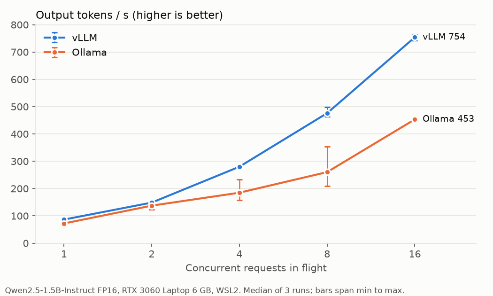
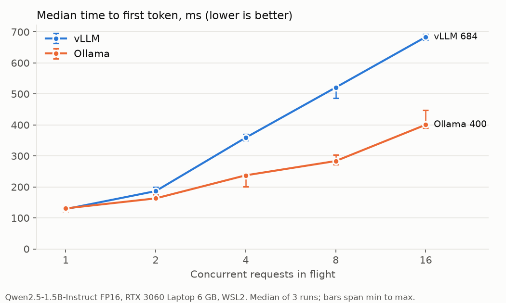
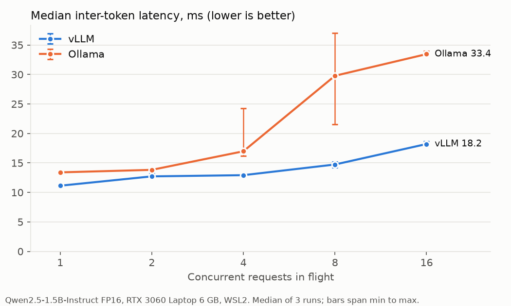

# llm-serving-bench: vLLM vs Ollama on a 6 GB laptop GPU

A small, controlled benchmark of two LLM servers, [vLLM](https://github.com/vllm-project/vllm)
and [Ollama](https://github.com/ollama/ollama), serving the same model at the same precision
through their OpenAI-compatible APIs on one RTX 3060 Laptop GPU under WSL2.

Every number in the tables, plots and resume block below is generated by `bench/report.py` from
the saved run files in `results/runs/` and written into this README between marker comments. None
is typed by hand. The prose quotes those tables.

## Summary

- **Throughput: vLLM wins at every concurrency level**, from 1.08x (2 requests) to 1.83x
  (8 requests), and 1.20x with a single request. Even against Ollama's *best* repeat at each
  level, vLLM's median is 1.07x-1.65x higher.
- **Per-request streaming speed (ITL): vLLM wins everywhere**, and the gap widens with load: at
  16 requests each vLLM stream gets a token every 18.2 ms against 33.4 ms on Ollama.
- **Time to first token: Ollama wins once there is concurrency** (median 1.14x-1.84x lower at
  2-16 requests); at one request it is a tie (131 vs 128 ms). Section 4 shows why: fewer
  prompts were queued ahead of each Ollama request, not faster prefill.
- **Ollama is lighter to run**: ready in seconds, model loaded in 16-18 s, against 42-76 s
  for vLLM to start, and less GPU memory held (vLLM reserves 80% of VRAM up front).
- **Ollama is less consistent at 4 and 8 concurrent requests**: its throughput moved by up to
  1.7x between repeats. Each request ran at one of two speeds, 1.7x-2x apart. Section 2
  narrows down where that comes from.

## Results



<!-- results:start -->
### Throughput and latency (median of 3 runs; ranges are min–max)

| Server | Concurrency | Output tok/s | Req/s | TTFT p50 (ms) | TTFT p90 (ms) | ITL p50 (ms) | Token gap p99 (ms) | E2E p50 (s) |
|---|---|---|---|---|---|---|---|---|
| vLLM | 1 | 86 (85–86) | 0.34 | 128 (125–134) | 178 | 11.1 (11.1–11.3) | 12 | 2.97 |
| Ollama | 1 | 72 (70–73) | 0.28 | 131 (120–138) | 198 | 13.4 (13.2–13.6) | 18 | 3.53 |
| vLLM | 2 | 148 (143–152) | 0.58 | 186 (174–199) | 258 | 12.7 (12.4–13.2) | 14 | 3.45 |
| Ollama | 2 | 137 (123–138) | 0.54 | 163 (162–175) | 250 | 13.8 (13.8–13.9) | 19 | 3.70 |
| vLLM | 4 | 280 (276–282) | 1.09 | 359 (350–371) | 460 | 12.9 (12.8–13.1) | 14 | 3.66 |
| Ollama | 4 | 185 (157–233) | 0.72 | 237 (201–243) | 428 | 17.0 (16.2–24.3) | 88 | 4.63 |
| vLLM | 8 | 476 (463–498) | 1.86 | 521 (486–521) | 764 | 14.7 (14.2–15.2) | 18 | 4.30 |
| Ollama | 8 | 260 (209–353) | 1.02 | 283 (272–303) | 581 | 29.8 (21.6–37.0) | 116 | 7.85 |
| vLLM | 16 | 754 (742–766) | 2.94 | 684 (674–693) | 1,094 | 18.2 (18.1–18.6) | 198 | 5.43 |
| Ollama | 16 | 453 (449–456) | 1.77 | 400 (390–448) | 856 | 33.4 (33.4–34.0) | 138 | 9.00 |

### Output length, memory and clocks (median of 3 runs)

| Server | Concurrency | Mean output tokens | Share hitting 256 | Peak GPU mem (MiB) | Idle baseline (MiB) | GPU util (%) | SM clock busy (MHz) | Max temp (C) | WSL RAM free (MiB) | Swap used (MiB) | Errors |
|---|---|---|---|---|---|---|---|---|---|---|---|
| vLLM | 1 | 256 | 1.00 | 5,483 | 384 | 99 | 1,453 | 87 | 4,653 | 16 | 0 |
| Ollama | 1 | 256 | 1.00 | 4,472 | 359 | 87 | 1,341 | 87 | 6,093 | 3 | 0 |
| vLLM | 2 | 256 | 1.00 | 5,494 | 384 | 99 | 1,537 | 87 | 4,652 | 16 | 0 |
| Ollama | 2 | 256 | 1.00 | 4,448 | 359 | 84 | 1,630 | 89 | 6,096 | 3 | 0 |
| vLLM | 4 | 256 | 1.00 | 5,465 | 384 | 99 | 1,611 | 87 | 4,652 | 16 | 0 |
| Ollama | 4 | 256 | 1.00 | 4,460 | 359 | 81 | 1,582 | 87 | 6,097 | 3 | 0 |
| vLLM | 8 | 256 | 1.00 | 5,494 | 384 | 99 | 1,532 | 87 | 4,649 | 16 | 0 |
| Ollama | 8 | 256 | 1.00 | 4,463 | 359 | 74 | 1,626 | 88 | 6,095 | 3 | 0 |
| vLLM | 16 | 256 | 1.00 | 5,464 | 384 | 99 | 1,534 | 87 | 4,655 | 16 | 0 |
| Ollama | 16 | 256 | 1.00 | 4,472 | 359 | 64 | 1,607 | 89 | 6,091 | 3 | 0 |

### vLLM relative to Ollama (ratio of medians)

| Concurrency | Throughput vLLM/Ollama | Throughput vLLM median / Ollama best repeat | TTFT p50 vLLM/Ollama | ITL p50 vLLM/Ollama |
|---|---|---|---|---|
| 1 | 1.20x | 1.18x | 0.98x | 0.83x |
| 2 | 1.08x | 1.07x | 1.14x | 0.92x |
| 4 | 1.52x | 1.20x | 1.51x | 0.76x |
| 8 | 1.83x | 1.35x | 1.84x | 0.49x |
| 16 | 1.66x | 1.65x | 1.71x | 0.54x |

Throughput above 1 favours vLLM; TTFT and ITL below 1 favour vLLM.
<!-- results:end -->




### Mechanism checks

Computed from the per-request records by `bench/analysis.py`.

<!-- analysis:start -->
Assumed ITL floor at concurrency 1: 3.09 GB of weights / 336 GB/s spec bandwidth = 9.2 ms per token.

| | vLLM | Ollama |
|---|---|---|
| Prefill at c=1, fitted (prompt tok/s) | 7,226 | 5,989 |
| Fixed TTFT overhead at c=1, fitted (ms) | 26 | 11 |
| Fit quality r² (TTFT vs prompt tokens) | 0.98 | 0.95 |
| ITL at c=1, all requests pooled (ms) | 11.2 | 13.4 |
| Memory clock while busy, all runs (MHz, min-max) | 7,100–7,100 | 7,100–7,100 |
| Weight bandwidth implied at c=1 (GB/s) | 276 | 231 |
| Share of spec bandwidth at c=1 | 82% | 69% |
| Aggregate decode at c=2 (tok/s, efficiency vs ideal) | 157 (88%) | 145 (97%) |
| Aggregate decode at c=4 (tok/s, efficiency vs ideal) | 308 (86%) | 240 (80%) |
| Aggregate decode at c=8 (tok/s, efficiency vs ideal) | 544 (76%) | 287 (48%) |
| Aggregate decode at c=16 (tok/s, efficiency vs ideal) | 870 (61%) | 476 (40%) |
| Token gap at c=1: p99 / max (ms) | 13 / 16 | 18 / 28 |
| Token gap at c=2: p99 / max (ms) | 15 / 169 | 35 / 329 |
| Token gap at c=4: p99 / max (ms) | 14 / 292 | 86 / 135 |
| Token gap at c=8: p99 / max (ms) | 18 / 313 | 113 / 153 |
| Token gap at c=16: p99 / max (ms) | 200 / 323 | 137 / 165 |
| GPU utilization at c=1 (nvidia-smi, run mean) | 99% | 87% |
| GPU utilization at c=2 (nvidia-smi, run mean) | 99% | 84% |
| GPU utilization at c=4 (nvidia-smi, run mean) | 99% | 81% |
| GPU utilization at c=8 (nvidia-smi, run mean) | 99% | 74% |
| GPU utilization at c=16 (nvidia-smi, run mean) | 99% | 64% |
| c=16: requests still in prefill when a request arrives (mean) | 5.9 (4,197 prompt tokens) | 1.4 (1,054 prompt tokens) |
| c=16: TTFT p50 when 0 requests are ahead in prefill (ms, n) | 98 (n=21) | 270 (n=60) |
| c=16: TTFT p50 when 1 requests are ahead in prefill (ms, n) | 277 (n=21) | 361 (n=136) |
| c=16: TTFT p50 when 2-3 requests are ahead in prefill (ms, n) | 493 (n=42) | 497 (n=131) |
| c=16: TTFT p50 when 4+ requests are ahead in prefill (ms, n) | 719 (n=252) | 880 (n=9) |

Per-request ITL modes: share of requests whose ITL is over 1.4x the fastest quartile at that level (median ITL of the fast / slow requests in brackets).

| Server | Concurrency | Repeat 1 | Repeat 2 | Repeat 3 |
|---|---|---|---|---|
| vLLM | 1 | 0% (11.1 / - ms) | 0% (11.3 / - ms) | 0% (11.1 / - ms) |
| vLLM | 2 | 0% (12.4 / - ms) | 0% (13.2 / - ms) | 0% (12.7 / - ms) |
| vLLM | 4 | 0% (12.8 / - ms) | 0% (12.9 / - ms) | 0% (13.1 / - ms) |
| vLLM | 8 | 0% (14.2 / - ms) | 0% (15.2 / - ms) | 0% (14.7 / - ms) |
| vLLM | 16 | 0% (18.1 / - ms) | 0% (18.6 / - ms) | 0% (18.2 / - ms) |
| Ollama | 1 | 0% (13.6 / - ms) | 0% (13.4 / - ms) | 0% (13.2 / - ms) |
| Ollama | 2 | 0% (13.9 / - ms) | 12% (13.7 / 29.6 ms) | 0% (13.8 / - ms) |
| Ollama | 4 | 0% (16.2 / - ms) | 25% (16.8 / 32.6 ms) | 50% (16.4 / 32.4 ms) |
| Ollama | 8 | 0% (21.6 / - ms) | 50% (21.3 / 37.7 ms) | 100% (- / 37.0 ms) |
| Ollama | 16 | 0% (34.0 / - ms) | 0% (33.4 / - ms) | 0% (33.4 / - ms) |
<!-- analysis:end -->

### Fairness checks

<!-- fidelity:start -->
- 768 requests were sent to both servers with identical text.
- Prompt token count difference (Ollama minus vLLM): min 0, max 0 (prompts ran from 192 to 1208 tokens), so both applied the same chat template and tokenizer.
- Identical full 256-token greedy output: 67% of requests; identical first 60 characters: 100%.
<!-- fidelity:end -->

### Startup and memory per server launch

<!-- startup:start -->
| Launch | Server | Repeats | API ready (s) | First model load (s) | GPU mem idle before (MiB) | GPU mem loaded, idle (MiB) |
|---|---|---|---|---|---|---|
| 0 | vLLM | 1 | 42 | in API ready | 359 | 5,261 |
| 1 | Ollama | 1, 2 | 6 | 16 | 359 | 4,395 |
| 2 | vLLM | 2, 3 | 76 | in API ready | 384 | 5,276 |
| 3 | Ollama | 3 | 7 | 18 | 427 | 4,474 |

vLLM loads the weights, compiles and captures CUDA graphs before its API answers; Ollama's API answers first and loads the model on the first request.
<!-- startup:end -->

## Why they diverge

Numbers below come from the tables above. "Mechanism checks" are computed by `bench/analysis.py`
from every request's timestamps, and log facts are quoted from the server logs in `results/logs/`
(gzipped).

### 1. One request at a time: both servers are limited by memory bandwidth

To write one token, the model has to read every weight once: 3.09 GB. It also reads the
**KV cache**, the keys and values it saved for every earlier token, so it never has to
reprocess them. Here that is 28 KiB per token (28 layers x 2 KV heads x 128 values x key and
value x 2 bytes).

```
prompt   [Note][1][:][On][day] ... [words][.]       prefill: all prompt tokens at once -> TTFT
cache    [K,V][K,V][K,V][K,V][K,V] ... [K,V]        28 KiB per token
decode   next token = read ALL 3.09 GB of weights + the cache, then append its own [K,V]  -> ITL
```

At the GPU's spec bandwidth of about 336 GB/s, reading 3.09 GB takes at least **9.2 ms per token**,
whichever server does it. vLLM's single-request ITL is 11.2 ms (82% of that limit), Ollama's is
13.4 ms (69%). The memory clock read 7,100 MHz in every busy sample on both servers, so this is
not a clock difference. Ollama kept the GPU busy 87% of the time against vLLM's 99%, so part of
Ollama's extra 2.2 ms per token is the GPU waiting between steps. vLLM replays CUDA graphs
captured at startup (its log shows the capture), which removes most kernel-launch work from each
step. I did not check whether Ollama's llama.cpp build uses CUDA graphs. Net: **1.20x more tokens/s
for vLLM at one request**.

Time to first token at one request is a tie (128 vs 131 ms). Fitting TTFT against prompt length
gives vLLM the faster prefill (7,226 vs 5,989 prompt tokens/s) but a larger fixed cost per
request (26 vs 11 ms). At these prompt lengths, 192 to 1,208 tokens, the two cancel.

### 2. Many requests: both batch continuously, vLLM wastes less time per step

Batching pays because one decode step reads the weights once for *every* request in the batch.
**Continuous batching** re-forms the batch at every step: a finished request leaves at once, and
a new one joins on the next step instead of waiting for the whole batch.

```
step:      1     2     3     4     5     6
req A:     a1    a2    a3    a4   done
req B:     b1    b2    b3    b4    b5    b6
req C:          [prefill C]  c1    c2    c3     <- joins mid-flight
req D:                            [prefill D]   <- takes A's place at once
```

**Both servers do this here.** Ollama 0.40.12 runs llama.cpp's `llama-server` with 16 slots
(`-np 16` in its log), so the gap is not "batching vs no batching". The difference is what each
extra request costs:

- ITL grows from 11.1 to 18.2 ms on vLLM between 1 and 16 requests, but from 13.4 to 33.4 ms on
  Ollama. Against perfect batching (each extra request free), vLLM keeps 61% of the ideal
  aggregate decode rate at 16 requests and Ollama 40%.
- **GPU utilization explains most of it.** vLLM keeps the GPU 99% busy at every level. Ollama
  falls from 87% at one request to 64% at 16, so its extra cost per request is mostly time the GPU
  sits idle, i.e. host-side work per step that grows with the number of sequences. A likely
  contributor, which I did not profile: llama.cpp picks each slot's next token on the CPU, from
  that slot's full row of 151,936 vocabulary scores, while vLLM samples on the GPU (its log
  reports FlashInfer sampling).

**Ollama's two speeds at 4 and 8 requests.** In those runs each request ran either fast (about 16 ms
per token at c=4, 21 ms at c=8) or slow (about 32 and 37 ms) and kept that speed for its whole
life. The share of slow requests per repeat was 0/25/50% at c=4 and 0/50/100% at c=8, in the
same order as those repeats' throughput, so this mode split is what drives Ollama's run-to-run
spread there. Ruled out: heat (similar SM clocks), the memory clock (7,100 MHz throughout) and
host memory (about 6 GB of WSL RAM free and under 20 MiB of swap in use, per the table above). Matching requests to the slot that served them (`results/ollama_slot_modes.md`) gives a lead:
in repeat 2, the slow requests are exactly those on the slots where llama-server's rotation wraps
from 15 back to 0 (slots 15 and 0 at c=2; 13-15 and 0 at c=4; 11-15 and 0-2 at c=8).
llama-server keeps a separate KV region per slot (`kv_unified = false` in its log), so a per-step
cost set by the *range* of slot numbers active together would produce this. Repeat 3 does not fit
as cleanly (every slot slow at c=8), and I have not confirmed the mechanism in llama.cpp's source.
The medians include both speeds. Against Ollama's best repeat, vLLM is still 1.20x faster at c=4
and 1.35x at c=8.

### 3. KV cache and paged attention: memory, not speed, at this scale

The two servers store the KV cache differently:

```
Ollama / llama.cpp: a fixed region per slot, reserved when the model loads
  slot 0  [AAAAAA····································]  2,048 tokens
  slot 1  [BBBBBBBBBBBBBB····························]  2,048 tokens
  ... x 16 = 896 MiB, held even when a request uses 300 tokens      (· = reserved, unused)

vLLM (paged attention): one shared pool of 16-token blocks, 56,048 tokens = 1.5 GiB
  pool    [A][B][A][C][B][A][C][ ][ ][ ][ ] ...
  block table:  A -> blocks 0,2,5   B -> 1,4   C -> 3,6     (waste: under 16 tokens per request)
```

vLLM's attention kernel follows the block table, the way an operating system maps virtual memory
onto physical pages. With at most 16 requests of at most 2,048 tokens, Ollama's fixed regions fit
easily, so paging is not what limits Ollama in this study. It shows up as **headroom**: vLLM's pool
could hold about 38 of the longest requests here (1,464 tokens) at once. Where it would bite: 64
Ollama slots of 2,048 tokens would need 3.5 GiB of KV cache, which does not fit next to 2.9 GiB of
weights on a 6 GB GPU. The memory cost of vLLM's design is the up-front reservation: it claims
80% of VRAM at startup (`--gpu-memory-utilization 0.80`), so its peak device memory (5,494 MiB)
is what it reserved, not what it needed. Ollama's peak was 4,530 MiB. Both include the Windows
desktop's 359-427 MiB.

### 4. Time to first token under load: fewer prompts were queued ahead in Ollama

Ollama's median TTFT is lower from two requests up, although its prefill is slower per token.
At 16 requests, a new vLLM request found on average **5.9 earlier requests (4,197 prompt tokens)
still waiting for their first token**, against 1.4 requests (1,054 tokens) on Ollama. With the same
number ahead, vLLM was as fast or faster: 98 vs 270 ms with none ahead, 493 vs 497 ms with two or
three ahead.

Why more queue up on vLLM: in this closed-loop test every request is exactly 256 tokens long, and
vLLM decodes at an even speed. Requests that start together finish together, so the client sends
their replacements in bunches. vLLM also completes 2.94 requests/s against Ollama's 1.77, so about
1.7x more prompts per second need prefilling. Ollama's uneven per-request speed spreads its
completions out. This is a property of the closed-loop test as much as of the servers. An
open-loop test with random (Poisson) arrivals would separate the two; this study did not run one.

The schedulers also trade TTFT against smooth streaming differently. vLLM schedules the running
decodes first in each step and fills the rest of a 2,048-token budget (its default on this GPU)
with prompt chunks; llama-server batches at most 512 tokens per step (`-b 512`). Up to 8 requests,
this keeps vLLM's token gaps tiny: p99 of 14-18 ms against 35-113 ms on Ollama, all requests
pooled. At 16 requests vLLM's larger prompt chunks stall the running streams for longer (p99 200
vs 137 ms).

### Where each server wins

| | vLLM | Ollama |
|---|---|---|
| Output tokens/s | every level, 1.08x-1.83x | - |
| Per-stream speed (ITL) | every level | - |
| Consistency across repeats | spread within about 8% | up to 1.7x at c=4 and 8 |
| Time to first token | tie at one request | 1.14x-1.84x lower from 2 to 16 requests |
| Worst token gap at 16 requests (p99) | - | 137 vs 200 ms |
| Startup and memory | - | ready in seconds, loaded in 16-18 s, smaller footprint |

### What would sharpen this

- An open-loop (Poisson arrival) run, to separate TTFT from the closed-loop bunching in section 4.
- An Nsight Systems trace of Ollama at 8 requests, to confirm where its GPU idle time goes and
  whether the slot-wrap lead in section 2 is the cause.
- Concurrency above 16 and longer contexts, where Ollama's fixed per-slot KV regions stop fitting
  and paged attention starts deciding throughput.

## Resume numbers

<!-- resume:start -->
```text
Model / precision: Qwen2.5-1.5B-Instruct, FP16 weights and FP16 KV cache on both servers
  (vLLM: HF safetensors cast BF16->FP16; Ollama: qwen2.5:1.5b-instruct-fp16 GGUF)
Workload: 64 seeded prompts, greedy, max 256 output tokens, concurrency 1-16, median of 3 runs

            tok/s @1    TTFT @1  tok/s @16    TTFT @16  peak GPU mem
vLLM            86.4     128 ms        754      684 ms     5,494 MiB
Ollama          72.1     131 ms        453      400 ms     4,530 MiB

Throughput ratio vLLM/Ollama: 1.20x at concurrency 1, 1.66x at 16
Peak GPU memory is device-wide memory.used from nvidia-smi (WSL2 has no per-process view) and
  includes the Windows desktop's 359 MiB idle baseline. vLLM pre-reserves
  --gpu-memory-utilization 0.80 of VRAM, so its number is a reservation, not what it needed.

GPU: NVIDIA GeForce RTX 3060 Laptop GPU (6144 MiB), driver 592.00, CUDA 13.1 (driver API)
vLLM 0.32.0 (torch 2.13.0, CUDA runtime 13.0); Ollama 0.40.12
WSL2 Ubuntu 24.04.4 LTS, kernel 6.6.114.1-microsoft-standard-WSL2; Microsoft Windows [Version 10.0.26300.9711]; power plan Turbo
Benchmark commit 8156fd555628
```
<!-- resume:end -->

## What is measured

| Metric | Definition (client-side, `time.perf_counter`) |
|---|---|
| Time to first token (TTFT) | request sent -> first streamed chunk with non-empty content |
| Inter-token latency (ITL) | per request: (last content chunk - first content chunk) / (output tokens - 1) |
| Token gap p99 | 99th percentile of the gaps between consecutive content chunks, over all requests in a run |
| Output tokens / s | all completion tokens in a run / run wall time |
| Requests / s | completed requests / run wall time |
| GPU memory | device-wide `memory.used`, sampled every 100 ms by `nvidia-smi` during each run |

Token counts come from each server's own `usage` field (`stream_options.include_usage`).

## How

**Same model, same precision.** Qwen2.5-1.5B-Instruct in FP16 on both servers, FP16 KV cache on both.

- vLLM loads the Hugging Face checkpoint (`Qwen/Qwen2.5-1.5B-Instruct`, revision
  `989aa7980e4cf806f80c7fef2b1adb7bc71aa306`). The checkpoint is stored in BF16; vLLM casts it
  to FP16 (`--dtype float16`).
- Ollama loads `qwen2.5:1.5b-instruct-fp16` (GGUF, quantization F16), through an alias
  (`ollama/Modelfile`) that only changes sampling defaults.
- Not byte-identical: the GGUF was converted from the same release by Ollama, and GGUF keeps
  1-D tensors such as norm weights in F32. Both runs do FP16 matrix multiplies on the same weights.

**Same work.** 64 seeded synthetic prompts (`data/prompts.jsonl`, built by `bench/prompts.py`),
each a list of 3-30 "field notes" plus an instruction to write a long report. Greedy decoding,
every penalty off, `max_tokens=256`. Ollama's OpenAI API has no `ignore_eos`, so the prompts ask
for 800+ words, and the results report how often each server actually reached 256 tokens.

**Same limits.** Both servers allow at most 16 sequences at once (vLLM `--max-num-seqs 16`,
Ollama `OLLAMA_NUM_PARALLEL=16`) and a 2048-token context per request.

**No cache tricks.** Every request in the study starts with a unique tag (`Session r2c08i017. ...`),
identical across servers, so neither server can reuse a cached prompt prefix from an earlier request.
Prompt caching is also switched off on both (vLLM `--no-enable-prefix-caching`, Ollama
`LLAMA_ARG_CACHE_RAM=0`). Ollama's llama-server keeps a host-RAM prompt cache by default with an
8 GiB limit. In a first attempt it grew to 8.1 GiB on this 7.6 GB WSL instance while giving no
hits, so leaving it on would have measured swapping, not serving (`results/aborted/`).

**Load pattern.** Closed loop: at concurrency *c* the client keeps exactly *c* requests in flight
(levels 1, 2, 4, 8, 16), sending max(16, 8c) requests per run. Each server launch starts with a
30 s warmup at concurrency 16, and each level gets one unmeasured wave of *c* requests first.

**Repeats and ordering.** Only one server fits in 6 GB, so the study alternates whole server
launches: vLLM r1 | Ollama r1 r2 | vLLM r2 r3 | Ollama r3. Each server gets an early, a middle
and a late repeat, so the GPU heating up over the evening does not favour either one. Within a
repeat the concurrency levels run in a seeded shuffled order, the same for both servers. Tables
report the median of the 3 repeats, with min-max ranges.

**Provenance.** Every run file embeds the git commit, GPU, driver, CUDA, package and server
versions, power plan, the launch script and the prompt-file hash. `bench/study.py` refuses to
record with uncommitted changes to tracked files, or when Windows is not on the Turbo power plan.

## Limitations

- **One laptop GPU.** An RTX 3060 Laptop (6 GB, about 336 GB/s by spec) in a laptop chassis.
  The clock drops as the GPU heats up, so every run records its SM clock and temperature. Absolute
  numbers will not transfer to datacenter GPUs, where vLLM's design targets much larger batches.
- **WSL2.** The GPU is reached through WSL's paravirtualized driver (`dxg`). vLLM reports that
  pinned host memory is unavailable under WSL and falls back. `nvidia-smi` cannot attribute memory
  to processes under WSL, so memory is device-wide and includes the Windows desktop's idle baseline.
  WSL had 7.6 GB of RAM, and Ollama disabled mmap because of host memory pressure (load time only).
- **One model size, one precision, short contexts.** A 1.5B model in FP16, prompts of 192 to
  1,208 tokens, 256 output tokens, concurrency up to 16. Larger models, quantized weights,
  long contexts or higher concurrency can change the picture. In particular, paged attention's
  memory advantage only bites once fixed per-slot reservations stop fitting.
- **Tuned limits, otherwise defaults.** Both servers are capped at 16 sequences and 2,048 tokens
  per request (`OLLAMA_NUM_PARALLEL=16`, `--max-num-seqs 16`), and prompt caching is off on both.
  Everything else is each server's default: vLLM's CUDA graphs, torch.compile and chunked
  prefill; Ollama's flash attention and its verbose llama-server logging.
- **Two earlier attempts were discarded**, not mixed in. Attempt 1 died after about 10 minutes
  with its launching client; attempt 2 was stopped to turn prompt caching off. Their files and a
  note on each are in `results/aborted/`. Every reported run comes from one commit and one schedule.
- **Not byte-identical weights.** See "Same model, same precision" above. Greedy outputs match
  exactly for most requests and drift apart later in the rest, which is expected when two FP16
  implementations round differently.
- **Closed-loop load only.** The client keeps exactly *c* requests in flight. It measures
  capacity at a fixed concurrency, not latency under a Poisson arrival rate.
- **Client on the same machine.** The async client runs in the same WSL instance, so its CPU use
  is shared with the server's; it is the same client for both servers.

## Reproduce

Inside WSL2 (Ubuntu 24.04):

```bash
bash scripts/setup_vllm.sh          # venv at ~/llmbench/venv with vLLM
bash scripts/setup_ollama.sh        # user-space Ollama at ~/llmbench/ollama
bash scripts/setup_ollama_model.sh  # pulls the FP16 GGUF, creates the benchmark alias
bash scripts/py.sh -m bench.prompts # regenerates data/prompts.jsonl (seeded)
bash scripts/run_study_detached.sh  # full study, about an hour; progress in results/logs/study_console.log
bash scripts/py.sh -m bench.report  # table, plots and resume numbers from results/runs
```
